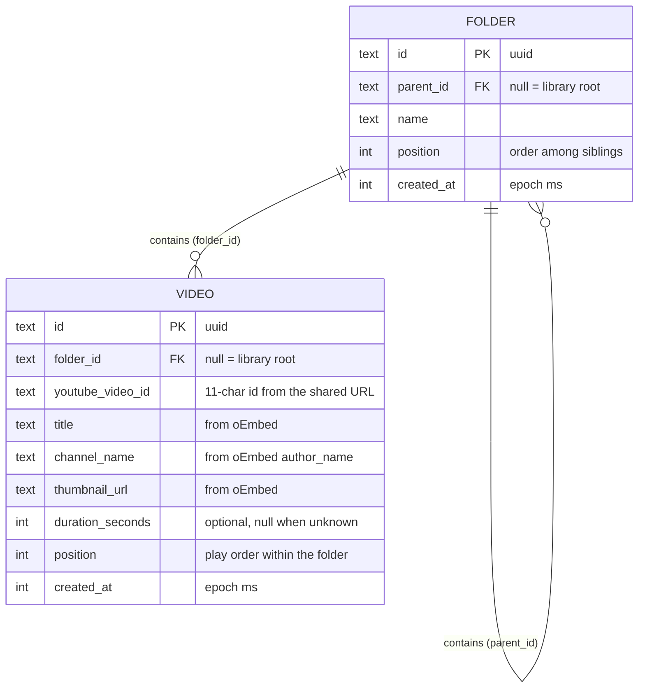

# Data model (proposed, awaiting approval)

Local SQLite only. Two tables, one self-referencing tree for folders and one for saved videos.

## Rules

- **Root:** `parent_id` / `folder_id` of `NULL` means the library root. No root row exists.
- **Nesting:** a folder's `parent_id` references `FOLDER.id`, any depth. Moving a folder into itself or its own descendant is rejected in the use case.
- **Delete:** deleting a folder deletes its subfolders and videos (`ON DELETE CASCADE`). The use case asks for confirmation when it is not empty.
- **Auto-advance:** the queue is `VIDEO` rows with the same `folder_id`, ordered by `position`. Subfolders are never queued.
- **Duplicates:** the same `youtube_video_id` may be saved in several folders, so it is not unique. Saving it twice in the same folder is allowed too, and can be revisited later.
- **Names:** folder names are unique among siblings (`parent_id`, `name`), checked in the use case.
- **Ordering:** `position` is per parent. Folders and videos are shown as two groups (folders first), matching the mockup, so they are ordered independently.

## Deviation from the spec

The spec suggests a single tree table with a `type` column. This model uses two tables instead. It avoids nullable video-only columns on folders and a type discriminator, and it maps to one repository per entity as in the architecture guide. Both fit the same UI.

## Repositories (data layer)

- `FolderRepositoryInterface`: create, rename, delete, move, reorder, `watchChildren(parentId)`, `getPath(folderId)` for breadcrumbs.
- `VideoRepositoryInterface`: add, rename, delete, move, reorder, `watchVideos(folderId)`.
